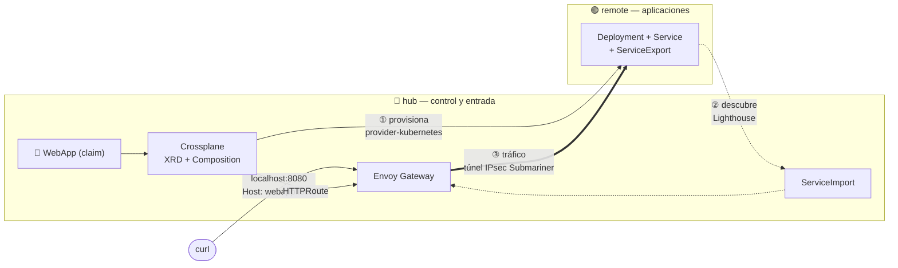

# hubble-and-spoke 🛰️

**Un solo YAML en un clúster → una aplicación corriendo en otro, publicada por un Gateway.**

Laboratorio local para aprender a fondo **Crossplane**, **Compositions**, **Gateway API**, **Envoy Gateway / xDS** y **Submariner**, con dos clústeres `kind`. Es material de aprendizaje, **no** una referencia de producción.

🎬 **[Recorrido 3D interactivo](https://oscarllamas6.github.io/hubble-and-spoke/)** · en local: `task tour`

## Qué construyes



El consumidor escribe esto ([webapp-claim.yaml](crossplane/examples/webapp-claim.yaml)):

```yaml
apiVersion: platform.lab.local/v1alpha1
kind: WebApp
metadata: { name: webapp, namespace: demo }
spec:
  image: traefik/whoami:v1.11.0
  replicas: 2
  hostname: webapp.local
```

Y la plataforma crea:

| Recurso | Dónde |
|---|---|
| Namespace, Deployment, Service | `remote` |
| ServiceExport | `remote` |
| HTTPRoute → ServiceImport | `hub` |

## Quickstart

Necesitas Linux, Docker, [Task](https://taskfile.dev/installation/) y `jq` ([detalle](docs/prerequisites.md)).

```bash
git clone https://github.com/OscarLlamas6/hubble-and-spoke.git
cd hubble-and-spoke
task up        # ~4-5 minutos
task test      # prueba de punta a punta
task down      # destruye todo
```

```bash
curl -H "Host: webapp.local" http://localhost:8080/
# Hostname: webapp-5f4cbd5db8-r8vtw   ← un pod que solo existe en remote
```

> Las CLIs se instalan en `./.bin` y el lab usa su propio kubeconfig (`./.kube/config`). No toca tu `~/.kube/config`. Para usar `kubectl` a mano: `source scripts/env.sh`.

## Por dónde empezar a aprender

| Si quieres… | Ve a |
|---|---|
| Verlo en imágenes | [Recorrido 3D](https://oscarllamas6.github.io/hubble-and-spoke/) |
| Construirlo paso a paso, rompiendo cosas | [docs/walkthrough.md](docs/walkthrough.md) |
| Entender cómo encaja todo | [docs/architecture.md](docs/architecture.md) |
| Saber por qué se hizo así | [docs/decisions.md](docs/decisions.md) |
| Algo no funciona | [docs/troubleshooting.md](docs/troubleshooting.md) |

## Índice de conceptos

Todos con la misma plantilla: qué es, qué problema resuelve, conceptos clave, uso en este repo, comandos y enlaces.

| Crossplane | Red y tráfico | Herramientas |
|---|---|---|
| [01 · Crossplane](docs/concepts/01-crossplane.md) | [07 · Gateway API](docs/concepts/07-gateway-api.md) | [06 · kind](docs/concepts/06-kind.md) |
| [02 · XRD y Compositions](docs/concepts/02-crossplane-compositions.md) | [08 · Envoy y Envoy Gateway](docs/concepts/08-envoy-gateway.md) | [11 · Helm](docs/concepts/11-helm.md) |
| [03 · Claims](docs/concepts/03-crossplane-claims.md) | [09 · xDS](docs/concepts/09-envoy-xds.md) | [12 · Taskfile](docs/concepts/12-taskfile.md) |
| [04 · Pipelines y Functions](docs/concepts/04-crossplane-pipelines-functions.md) | [10 · Submariner](docs/concepts/10-submariner.md) | [13 · subctl](docs/concepts/13-subctl.md) |
| [05 · provider-kubernetes](docs/concepts/05-provider-kubernetes.md) | [18 · IPsec / libreswan](docs/concepts/18-ipsec-libreswan.md) | [14 · Crossplane CLI](docs/concepts/14-crossplane-cli.md) |
| [15 · patch-and-transform](docs/concepts/15-function-patch-and-transform.md) | [19 · CoreDNS](docs/concepts/19-coredns.md) | [21 · Three.js y Pages](docs/concepts/21-threejs-github-pages.md) |
| [16 · go-templating](docs/concepts/16-function-go-templating.md) | [20 · Multi-Cluster Services API](docs/concepts/20-multicluster-services-api.md) | |
| [17 · auto-ready](docs/concepts/17-function-auto-ready.md) | | |

## Comandos

| Comando | Qué hace |
|---|---|
| `task up` / `task down` | ciclo de vida completo |
| `task test` | smoke test de punta a punta |
| `task status` | foto de todo el flujo |
| `task xds` | config efectiva de Envoy |
| `task crossplane:render` | pipeline en local, sin clúster |
| `task submariner:status` / `submariner:verify` | túnel y prueba cross-cluster |
| `task example:apply` / `example:delete` | gestionar claims (`FILE=…`) |
| `task tour` | recorrido 3D en local |

Fases sueltas: `tools`, `check-deps`, `clusters`, `submariner`, `crossplane`, `api`, `gateway`. También funciona `make up`, `make test`, `make down`.

## Estructura

```
.
├── Taskfile.yml · Makefile · versions.env
├── clusters/        configuración de kind (CIDRs, puertos)
├── submariner/      comandos, flags y prueba de conectividad
├── crossplane/      provider, functions, XRD, Composition, ejemplos
├── gateway/         EnvoyProxy, GatewayClass, Gateway
├── scripts/         lo que ejecuta cada task, comentado
├── docs/            arquitectura, walkthrough, troubleshooting, concepts/
└── tour/            recorrido 3D (GitHub Pages)
```

## Problemas comunes

| Síntoma | Primera acción |
|---|---|
| El kubelet no arranca / `too many open files` | límites de [inotify](docs/troubleshooting.md#problemas-de-instalación) |
| Túnel no conecta o CIDRs solapados | `task submariner:status` |
| `clusterset.local` no resuelve | espera ~1 min; revisa el `ServiceExport` |
| Claim en `READY=False` | `crossplane resource trace` ([método](docs/troubleshooting.md#método-sigue-la-cadena)) |
| 404 / 500 / 503 | [significado de cada uno](docs/troubleshooting.md#gateway--envoy) |

## Alcance

Fuera a propósito: clouds reales, TLS/cert-manager, observabilidad, CI/CD del lab, HA. Ver [qué haría distinto en producción](docs/architecture.md#qué-haría-distinto-en-producción).
