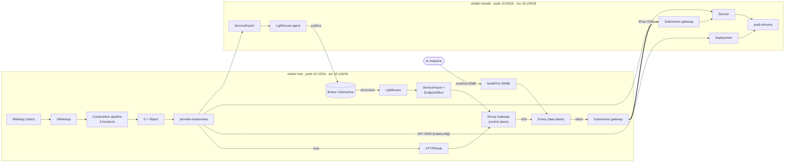
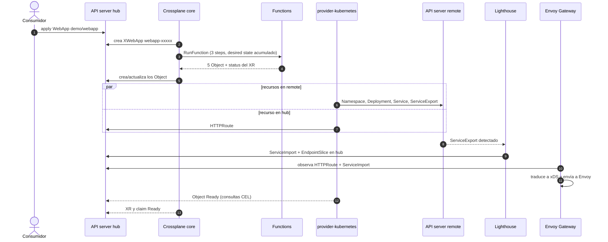
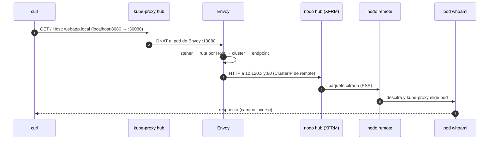
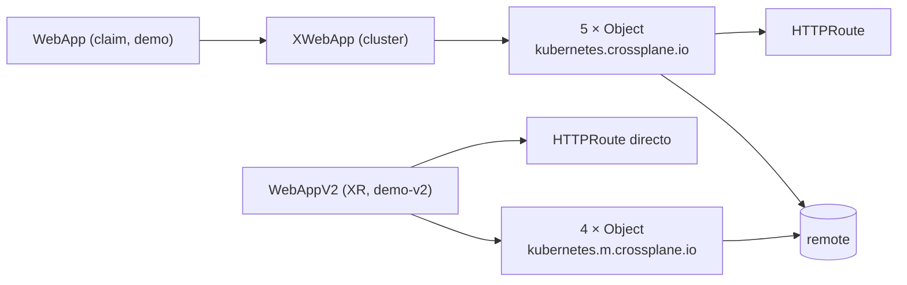

# Arquitectura: cómo interactúan las piezas

Este documento trata de las **relaciones**. Qué es cada tecnología está en [concepts/](concepts/).

## Vista de conjunto



## Tres planos que conviene no mezclar

| Plano | Quién habla con quién | Por dónde viaja | Si falla… |
|---|---|---|---|
| **Aprovisionamiento** | provider-kubernetes → API de `remote` | red Docker directa, HTTPS 6443 | no hay cambios nuevos; las apps siguen sirviendo |
| **Descubrimiento** | Lighthouse ↔ broker | red Docker, HTTPS 6443 hacia `hub` | los imports se quedan como estaban |
| **Datos** | Envoy → Service remoto | túnel IPsec entre gateways | las peticiones fallan (503) |
| *(config del proxy)* | Envoy Gateway → Envoy | xDS, dentro de `hub` | Envoy sigue con la última config recibida |

Punto que suele confundir: **Crossplane no usa Submariner**. Crossplane habla con el API server de `remote`; Submariner solo conecta pods y services.

## Flujo de aprovisionamiento



No hay orquestador que imponga orden: los 5 recursos se crean a la vez y **convergen por reintentos**. El `HTTPRoute` puede existir antes que el `ServiceImport`; durante esos segundos reporta `ResolvedRefs=False` y el claim no está `Ready`. En este lab todo converge en unos 30 s.

## Flujo de una petición



| Salto | Quién decide el destino | Dónde verlo |
|---|---|---|
| 1 | `extraPortMappings` | [kind-hub.yaml](../clusters/kind-hub.yaml) |
| 2 | Service NodePort | `khub -n envoy-gateway-system get svc` |
| 3 | config xDS | `task xds` |
| 4 | tabla de rutas 150 | `docker exec hub-control-plane ip route show table 150` |
| 5 | política XFRM | `docker exec hub-control-plane ip xfrm policy` |
| 6 | kube-proxy de remote | `kremote -n demo get endpointslices` |

## Quién crea qué (cadena de propiedad)

```
tú ──► WebApp ──► XWebApp ──► Object ×5 ──► Namespace/Deployment/Service/ServiceExport (remote)
                                        └─► HTTPRoute (hub)
Lighthouse ──► ServiceImport, EndpointSlice (hub)
Envoy Gateway ──► Deployment y Service de Envoy
```

Borrar el claim recorre la primera cadena hacia abajo; Lighthouse retira el import al desaparecer el export. El Namespace de `remote` queda huérfano a propósito.

## Las dos APIs

Ambas producen lo mismo y comparten Gateway, Submariner y credenciales.



Detalle: [22 · Crossplane v2](concepts/22-crossplane-v2.md).

## Acoplamientos a vigilar

Valores que deben coincidir en varios sitios; si cambias uno, cambia los demás.

| Valor | Aparece en |
|---|---|
| `hub-gateway` / `gateway-system` | `gateway/gateway.yaml`, Composition |
| `30080` | `kind-hub.yaml`, `envoyproxy.yaml` |
| CIDRs | `kind-*.yaml`, `scripts/submariner.sh` |
| ProviderConfig `remote` / `hub` | `providerconfig-*.yaml`, Composition |
| ServiceAccount `provider-kubernetes` | `provider-kubernetes.yaml` (runtime config y binding) |
| Nombres de functions | `functions.yaml`, `functionRef` |

## Qué haría distinto en producción

1. **HA de Submariner:** al menos dos gateway nodes por clúster (activo/pasivo) y broker en un clúster que no sea punto único de fallo; rotación de la PSK o WireGuard.
2. **Providers de cloud reales:** clústeres, redes y bases de datos como managed resources, con identidad federada (IRSA / Workload Identity) en vez de claves.
3. **GitOps (Argo CD o Flux):** XRDs, Compositions y claims desde git; nada de `kubectl apply` manual. Promoción entre entornos y revisiones de Composition con actualización controlada.
4. **Credenciales de mínimo privilegio:** sustituir el kubeconfig `cluster-admin` por un ServiceAccount restringido, con tokens de corta duración y gestor de secretos.
5. **TLS de punta a punta:** listener HTTPS con cert-manager, y mTLS o TLS hacia los backends.
6. **Políticas de red:** NetworkPolicies en ambos clústeres; hoy cualquier pod de `hub` puede llegar a los services de `remote`.
7. **Gobierno de la API:** `allowedRoutes` por selector, política que impida dos claims con el mismo hostname, cuotas por namespace.
8. **Observabilidad:** métricas de Envoy, Crossplane y Submariner en Prometheus, trazas, alertas sobre `Ready=False` y sobre el estado de las conexiones.
9. **Resiliencia de tráfico:** timeouts, reintentos y circuit breaking (`BackendTrafficPolicy`), varias réplicas de Envoy; endpoints a nivel de pod si se necesita balanceo L7 real.
10. **Solo Crossplane v2:** retirar la API v1 con claims; aquí conviven para aprender.
11. **CI para la plataforma:** ejecutar `task test:unit` en cada cambio de Composition.

Observabilidad queda como *stretch goal*: documentada, no implementada.
